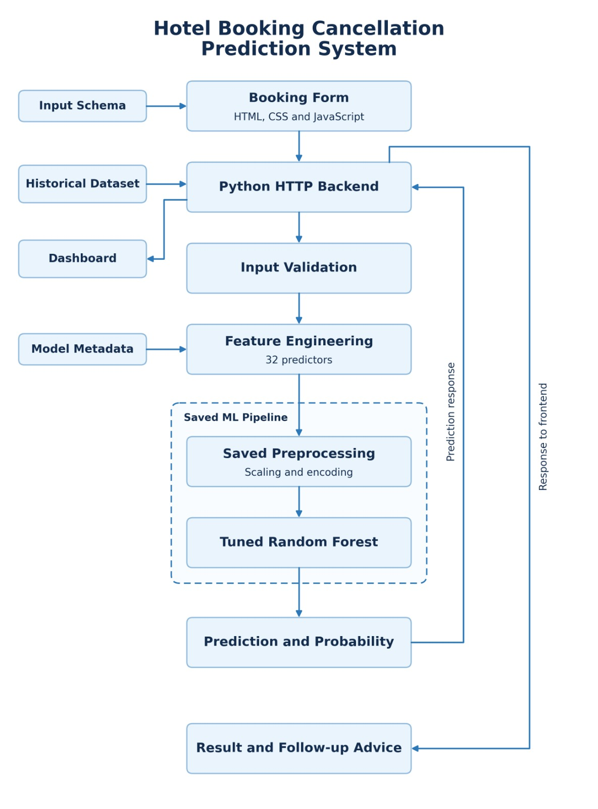
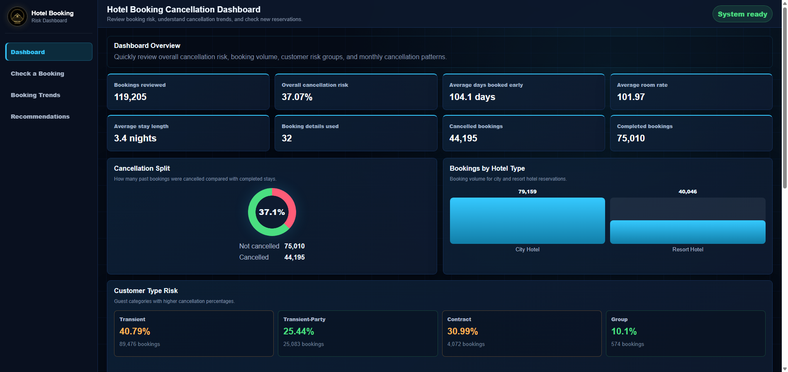
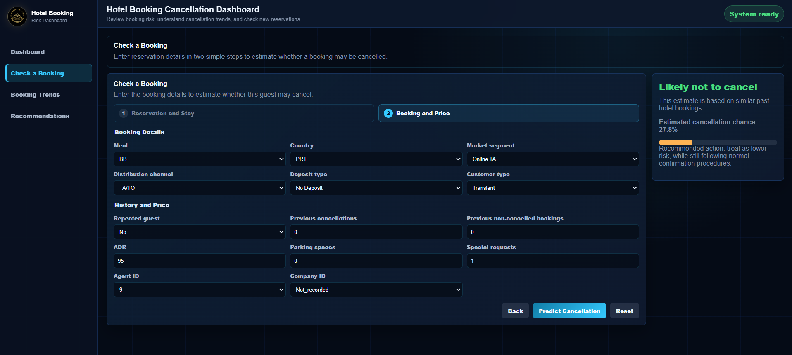
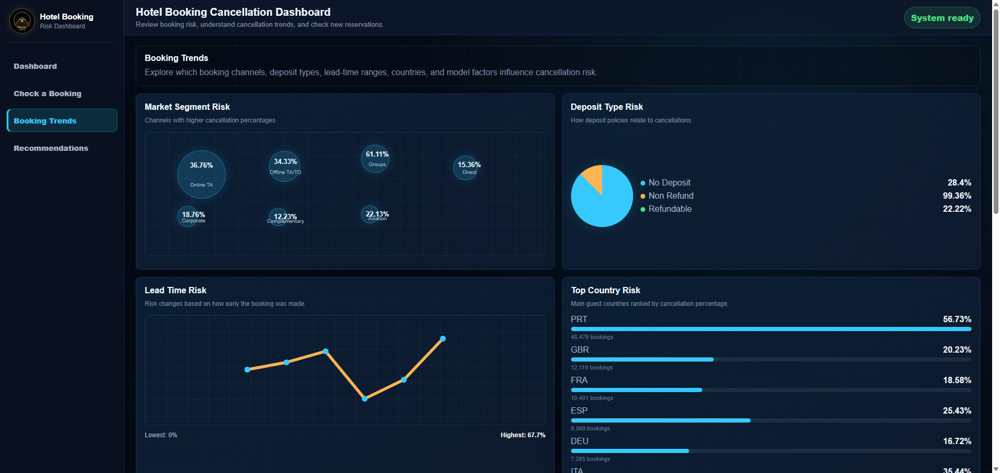
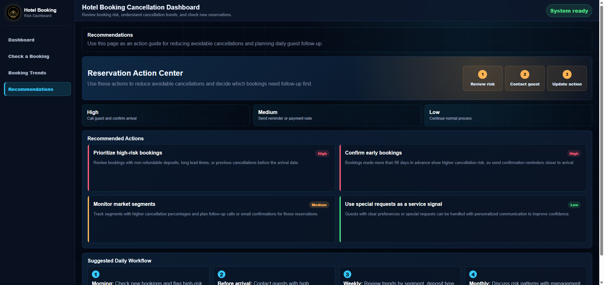

<div align="center">

<h1>Hotel Booking Cancellation Prediction System</h1>

<p>
  <strong>End-to-end machine learning system for predicting hotel booking cancellation risk.</strong>
</p>

<p>
  
  
  
  
  
  
</p>

</div>

---

<h2 align="center">About The Project</h2>

This project builds a complete **Hotel Booking Cancellation Prediction System** for the IT3051 Fundamentals of Data Mining mini project.

The system uses historical hotel booking data to estimate whether a new reservation is likely to be cancelled. It covers the full data mining workflow: dataset understanding, exploratory data analysis, preprocessing, feature engineering, model preparation, model evaluation, final model selection, backend integration, frontend development, and automated testing.

The final application is designed for hotel staff who need a simple way to review cancellation risk, understand booking trends, and decide which reservations may need follow-up.

---

<h2 align="center">Project Snapshot</h2>

| Area | Status | Main Output |
|---|---:|---|
| Dataset understanding | Complete | Data dictionary, quality review, suitability analysis |
| Exploratory data analysis | Complete | Booking, stay, customer, commercial and distribution insights |
| Data preprocessing | Complete | Cleaned dataset and validation reports |
| Feature engineering | Complete | Final selected predictor set and engineered features |
| ML data preparation | Complete | Shared train/test split and preprocessing pipeline |
| Model evaluation | Complete | Logistic Regression, Decision Tree, Random Forest, Gradient Boosting |
| Final model | Complete | Tuned Random Forest pipeline |
| Backend service | Complete | Prediction API, schema API, dashboard API |
| Frontend dashboard | Complete | Staff dashboard, prediction form, trends and recommendations |
| Automated tests | Complete | Cleaning, preprocessing, inference and backend endpoint checks |

---

<h2 align="center">Problem Statement</h2>

Hotels lose revenue and operational efficiency when bookings are cancelled unexpectedly. This system estimates cancellation risk using booking information available before the final reservation outcome.

| Item | Description |
|---|---|
| Prediction task | Binary classification |
| Target variable | `is_canceled` |
| Class `0` | Booking was not cancelled |
| Class `1` | Booking was cancelled |
| Intended user | Hotel staff or reservation managers |
| Main output | Cancellation prediction, probability and recommended action |

---

<h2 align="center">Dataset Summary</h2>

| Dataset Version | Shape |
|---|---:|
| Raw dataset | 119,390 rows x 36 columns |
| Cleaned dataset | 119,205 rows x 36 columns |
| Final modelling dataset | 119,205 rows with 32 selected predictors plus target |

Raw data is stored in `data/raw/`, and processed datasets are stored in `data/processed/`.

---

<h2 align="center">Core Features</h2>

<table>
<tr>
<td width="50%" valign="top">

### Data Mining Workflow
- Dataset understanding and data dictionary
- Missing value, duplicate and invalid value analysis
- Exploratory analysis of booking behaviour
- Cleaning, type correction and validation reports
- Feature engineering and predictor selection

</td>
<td width="50%" valign="top">

### Machine Learning
- Shared train/test split
- Shared preprocessing pipeline
- Logistic Regression, Decision Tree, Random Forest and Gradient Boosting
- Hyperparameter tuning and final model comparison
- Final selected model: Tuned Random Forest

</td>
</tr>

<tr>
<td width="50%" valign="top">

### Backend Service
- Loads final trained model and metadata
- Accepts and validates booking inputs
- Rebuilds required engineered features
- Uses the saved preprocessing and model pipeline
- Returns prediction label, probability and model details

</td>
<td width="50%" valign="top">

### Frontend Dashboard
- Staff-facing cancellation dashboard
- Two-step prediction form
- Input validation and dropdown options from backend schema
- Clear prediction result with probability
- Booking trends, model factors and recommended actions

</td>
</tr>

<tr>
<td width="50%" valign="top">

### Automated Testing
- Data-cleaning validation tests
- Preprocessing safety tests
- Predictor preparation checks
- Final-model inference test
- Backend API endpoint tests

</td>
<td width="50%" valign="top">

### Evaluation Support
- API test console at `/api/test`
- Health endpoint for service checks
- Schema endpoint for frontend options and ranges
- Dashboard endpoint for KPI and chart data
- Clear error handling for invalid requests

</td>
</tr>
</table>

---

<h2 align="center">Final Model</h2>

The selected production model is:

```text
Tuned Random Forest
```

Selection basis:

- Highest cross-validation F1-score among compared models.
- Strong held-out test performance across F1-score, ROC-AUC and PR-AUC.
- Improved recall compared with the baseline Random Forest while keeping accuracy stable.
- Feature ablation did not improve performance, so the full selected predictor set was retained.

Saved model artifacts:

```text
06_Model_Evaluation/Models/tuned_random_forest_pipeline.joblib
06_Model_Evaluation/Models/tuned_random_forest_metadata.json
```

The saved pipeline includes both preprocessing and the trained model, so backend predictions use the same transformations used during model development.

---

<h2 align="center">System Architecture</h2>

<p align="center">
  
</p>

---

<h2 align="center">Backend API</h2>

| Method | Endpoint | Purpose |
|---|---|---|
| `GET` | `/api/health` | Confirms the service and model are available |
| `GET` | `/api/schema` | Returns predictor columns, dropdown options and validation ranges |
| `GET` | `/api/dashboard` | Returns KPI, chart, recommendation and model insight data |
| `GET` | `/api/test` | Opens the API test console |
| `POST` | `/api/predict` | Accepts booking details and returns cancellation prediction |

Prediction responses include predicted class, staff-friendly prediction label, cancellation probability, model name/version and final feature values used by the model.

Invalid or missing inputs return a clear `400` response with field-level error messages.

---

<h2 align="center">Frontend Experience</h2>

| Section | Purpose |
|---|---|
| Dashboard | Shows total bookings, cancellation rate, average lead time, room rate and other KPIs |
| Check a Booking | Two-step form for entering reservation details and generating a prediction |
| Booking Trends | Shows cancellation patterns by channel, deposit type, country, lead time and model importance |
| Recommendations | Gives simple operational actions for reducing avoidable cancellations |

### Dashboard Overview

<p align="center">
  
</p>

### Booking Prediction Form

<p align="center">
  
</p>

### Booking Trends

<p align="center">
  
</p>

### Recommendations

<p align="center">
  
</p>

The API test console is available at:

```text
http://127.0.0.1:8001/api/test
```

---

<h2 align="center">Quick Start</h2>

Run all commands from the repository root.

### 1. Install dependencies

```powershell
.\.venv\Scripts\python.exe -m pip install -r requirements.txt
```

### 2. Start the backend and dashboard

```powershell
.\.venv\Scripts\python.exe backend\app.py 8001
```

### 3. Open the application

```text
http://127.0.0.1:8001
```

If an older version appears in the browser, hard refresh:

```text
Ctrl + F5
```

---

<h2 align="center">Running Tests</h2>

Run the automated test suite:

```powershell
.\.venv\Scripts\python.exe -m unittest discover -s tests -v
```

Current test coverage includes data-cleaning validation, preprocessing safety, predictor preparation, final-model inference, input validation and backend API endpoints.

Latest checked result:

```text
Ran 12 tests
OK
```

---

<h2 align="center">Workflow Deliverables</h2>

### 1. Dataset Understanding

```text
01_Dataset_Understanding/Dataset_Selection_and_Understanding.ipynb
```

Includes problem definition, dataset source, target explanation, data dictionary, missing values, duplicates, invalid values, unusual observations, class distribution, leakage review and suitability conclusion.

### 2. Exploratory Data Analysis

```text
02_EDA/EDA.ipynb
```

EDA covers booking behaviour, stay patterns, customer behaviour, commercial patterns and distribution channels. Generated figures are stored in `02_EDA/Figures/`.

### 3. Data Preprocessing

```text
03_Data_Preprocessing/Data_Preprocessing.ipynb
scripts/clean_hotel_bookings.py
```

Main cleaning decisions:

- Removed records with missing child counts.
- Removed zero-guest bookings.
- Removed negative ADR record.
- Filled missing `country`, `agent` and `company` values.
- Corrected count, categorical ID, binary and date-related data types.
- Retained valid extreme values where there was no strong evidence of error.

### 4. Feature Engineering and Selection

```text
04_Feature_Engineering/Feature_Engineering_and_Selection.ipynb
```

Engineered features:

- `total_stay`
- `total_guests`
- `has_children`
- `has_babies`
- `previous_total_bookings`
- `previous_cancellation_rate`

Feature-selection decisions:

- Retained useful original booking predictors.
- Retained engineered candidate predictors.
- Removed direct leakage fields such as `reservation_status` and `reservation_status_date`.
- Removed personal identifier fields.
- Removed fields likely unavailable or unstable at initial booking time.

### 5. ML Data Preparation

```text
05_ML_Data_Preparation/ML_Data_Preparation_and_Final_Validation.ipynb
```

Preparation summary:

```text
Input rows: 119,205
Selected predictors: 32
Training rows: 95,364
Test rows: 23,841
Transformed features: 116
```

Validation confirmed no overlapping train/test rows, no non-finite transformed values and no excluded leakage fields among predictors.

### 6. Model Evaluation

```text
06_Model_Evaluation/Shared_Model_Setup.ipynb
06_Model_Evaluation/Logistic_Regression.ipynb
06_Model_Evaluation/Decision_Tree.ipynb
06_Model_Evaluation/Random_Forest.ipynb
06_Model_Evaluation/Gradient_Boosting.ipynb
06_Model_Evaluation/Overall_Model_Comparison_and_Final_Selection.ipynb
```

Common modelling setup:

- Shared train/test split
- Shared preprocessing pipeline
- Stratified K-Fold cross-validation
- Common metrics: accuracy, precision, recall, F1-score, ROC-AUC and PR-AUC
- Hyperparameter tuning and final comparison

### 7. Backend and Frontend

Backend:

```text
backend/app.py
```

Frontend:

```text
frontend/index.html
frontend/app.js
frontend/styles.css
frontend/api-test.html
```

Stage 9 backend requirements covered:

- Loads final trained model and metadata.
- Accepts and validates user input.
- Computes required engineered features.
- Applies the saved preprocessing pipeline.
- Generates model predictions.
- Returns meaningful JSON responses.
- Handles invalid and missing inputs.

Stage 10 frontend requirements covered:

- Provides clear booking input fields.
- Uses a two-step form for better usability.
- Validates user inputs.
- Presents prediction results and probabilities clearly.
- Follows the hotel booking cancellation scenario.
- Provides a simple and understandable user experience.
- Works end to end with the backend API.

---

<h2 align="center">Repository Structure</h2>

```text
IT3051-FDM-Mini-Project-2026/
|-- 01_Dataset_Understanding/
|-- 02_EDA/
|   `-- Figures/
|-- 03_Data_Preprocessing/
|-- 04_Feature_Engineering/
|-- 05_ML_Data_Preparation/
|-- 06_Model_Evaluation/
|   |-- Figures/
|   `-- Models/
|       |-- tuned_random_forest_pipeline.joblib
|       `-- tuned_random_forest_metadata.json
|-- backend/
|   `-- app.py
|-- frontend/
|   |-- assets/
|   |   `-- luxury-hotel-logo.svg
|   |-- api-test.html
|   |-- index.html
|   |-- app.js
|   `-- styles.css
|-- data/
|   |-- raw/
|   `-- processed/
|-- docs/
|   |-- system-architecture.jpeg
|   |-- frontend-dashboard.png
|   |-- frontend-prediction.png
|   |-- frontend-trends.png
|   `-- frontend-recommendations.png
|-- scripts/
|-- tests/
|   |-- test_backend_service.py
|   |-- test_data_cleaning.py
|   `-- test_preprocessing.py
|-- requirements.txt
`-- README.md
```

---

<h2 align="center">Environment Note</h2>

The saved model metadata records scikit-learn `1.9.0`. `requirements.txt` is aligned to that version to avoid model persistence warnings when loading the saved pipeline.

<div align="center">

## Hotel Booking Cancellation Prediction System

End-to-end data mining, machine learning, backend and frontend system for hotel booking cancellation risk prediction.

</div>
